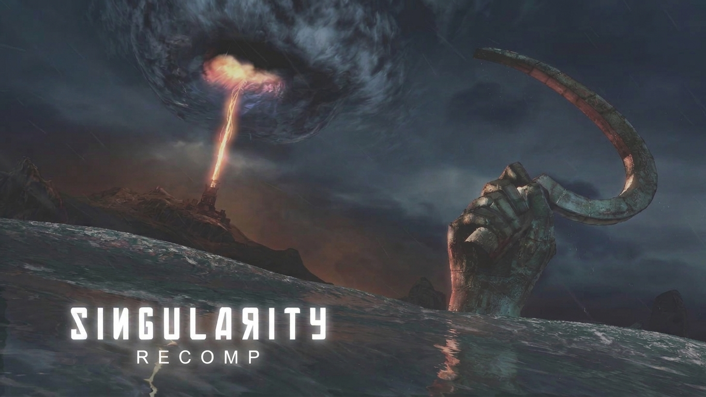

<div align=center>

</div>

---

Nintendo Switch port of the Xbox 360 version of Singularity (2010), built by static recompilation with rexglue-sdk and drawn by a native deko3d renderer.

The project is fully [vibecoded](https://share.google/jggfMaZ3mu2HW2Zd0).

It reuses the Unreal Engine 3 on Switch stack of [gears2-nx](https://github.com/VasilkovND/gears2-nx) (Gears of War 2), adapted to Singularity. The PC version is [singularity-recomp](https://github.com/panalexeu/singularity-recomp). It needs your **legally owned and purchased** Xbox 360 copy: no game data or recompiled code is part of this repository.

On a Switch Lite it runs at 960x540 with the CPU at 1785 MHz (the console's boost clock) and the GPU at 460.8 MHz: clean sound, heavy scenes playable, about 2 hours of battery. At the stock 1020 MHz CPU busy scenes drop below 20 fps and the sound crackles.

The game has not yet been tested from start to finish.

### Instructions

Requirements: a Switch with Atmosphere running homebrew in title takeover mode (hold R while starting a game); Linux with git, Python 3, CMake 3.25+, Ninja, clang-20, Docker; `dxc` and `spirv-val` from the Vulkan SDK.

1. Clone and set up the SDKs: rexglue-sdk-nx pinned to `f961303` in `thirdparty/rexglue-sdk-nx` plus `patches/rexglue-sdk-nx/`, upstream rexglue-sdk `v0.10.0` in `thirdparty/rexglue-sdk` (its `rexglue` codegen tool), and the Docker image with the Switch toolchain:

   ```bash
   git clone <this repo's URL> singularity-nx
   cd singularity-nx
   tools/setup.sh
   ```

2. Extract your copy of the game (`default.xex` and `RvGame/`) into `singularity-extract/` (gitignored). Only the v1.0 `default.xex` with SHA-256 `d55636b840319ca8b6b9b6e8c4fc06981803787af61c331ea56eacfb7ad5dac5` is supported.

3. Recompile the game code into `out/codegen-nx/` (never share it):

   ```bash
   tools/switch/codegen.sh
   ```

4. Build the shaders once (21,767 shaders, ~152,000 DKSH variants, takes hours):

   ```bash
   DXC=<path to dxc> VAL=<path to spirv-val> tools/switch/shaders.sh
   ```

5. Build the NRO (about an hour the first time; use `tools/switch/build-native.sh 2` on an 8 GB PC):

   ```bash
   tools/switch/build-native.sh
   ```

6. Optional, about +2-3 fps in big fights: turn off the characters' dynamic shadows in the game's own config (the NRO accepts the edited file: it recomputes the config's hash at startup). Other `[SystemSettings]` keys work the same way (`--list` shows them).

   ```bash
   python3 tools/switch/coalesced_settings.py singularity-extract/RvGame/CookedXenon/Coalesced_INT.bin \
     out/Coalesced_INT.bin LightEnvironmentShadows=False
   ```

   Copy `out/Coalesced_INT.bin` over `singularity-extract/RvGame/CookedXenon/Coalesced_INT.bin` on the SD card.

7. Copy to `sdmc:/switch/singularity/`: `out/build/switch-native/singularity.nro`, `switch/singularity.toml`, `out/shaders/singularity_shaders.dslib`, `out/shaders/shadercache_dksh.bin` and your `singularity-extract/` folder. Launch the NRO from the homebrew menu in title takeover mode; logs go to `logs/` next to it.

### Changes

Settings (`singularity.toml`):

| Setting | Effect in game |
|---|---|
| `singularity_switch_cpu_mhz = 1785` | CPU at the boost clock (0 = stock 1020): clean sound, smooth heavy scenes |
| `singularity_switch_gpu_mhz = 460` | The official 460.8 MHz handheld GPU mode |
| `singularity_resolution = 540` | 960x540 instead of 1280x720, about 56% of the pixel work |
| `singularity_patch_no_tiling = true` | Without it the bottom of the screen is red |
| `singularity_sin_prepaso_z`, `singularity_sin_prepaso_enmascarado` | Without them the world turns red, and windows, rubbish and debris show a staircase of old frames |
| `nfsmw_dk_compilar_variantes = false` | Never compiles a shader while playing (the general variant draws the same image); a runtime compile took a CPU core for 30+ s and the sound crackled |

Game patches (applied by `tools/switch/codegen.sh`):

| Patch | What it changes | Effect in game |
|---|---|---|
| 1 `patch_singularity.py` | `GUseTilingMode` (`0x83917A88`) set to 0 in `sub_82DAD680` | The scene is drawn once, not in two MSAA tiles (red bottom fixed) |
| 3 `patch_scene_resolution.py` | `sub_82DBFA80`'s hard-coded 720 height and 1280 width cap become 540 / 960 (from gears2-nx 1.1.0) | The 540p mode |
| ARM fixes, CPU passes | From the Gears of War 2 PC port and gears2-nx | Correct on ARM's memory model, 25-30% less CPU per frame |
| Clear emulation (`switch/src/singularity_gpu.cpp`) | Direct3D's clear rectangle takes its color from its vertices; the color written through the depth path is computed without float overflow | Projector slides in their real colors (they were red) |
| Perf hooks (`switch/src/singularity_perf_hooks.cpp`, from gears2-nx) | Direct3D's GPU and occlusion-query waits sleep instead of spinning; memcpy, memset and the audio mixer's state-variable filter (`sub_828EDF78`) run as native code | The spins took a core from the audio thread (crackling); the filter was 26% of the audio thread |

rexglue-sdk-nx patches (`patches/rexglue-sdk-nx/`):

| Patch | What was wrong | Effect in game |
|---|---|---|
| `0001` | gears2-nx's 49 SDK patches for Unreal Engine 3 on deko3d | Without them the game does not run or draws a broken image |
| `0002` | Occlusion results were read only after the frame's whole GPU work finished | The render thread waited ~15% of its time for them; now ~2% |
| `0003` | The background shader compiler ran pinned to one core | It may now use any core (and runs below the game where the system allows it) |
| `0004` | Waits on several objects polled every 1 ms | The game's audio thread woke up to 1 ms late for every 5.33 ms block of sound and missed blocks (crackling) |
| `0005` | A shader variant missing from the cache was compiled while playing | Optional now (`nfsmw_dk_compilar_variantes`) |
| `0006` | Textures the game writes at run time (the font atlas) were rechecked only every few frames | Letters were missing for a moment when text first appeared |
| `0007` | A stencil-only clear was remembered as a depth clear, so the full depth clear after it was skipped | World objects in front of you cut away parts of your gun |
| `0008` | The texture descriptor table had 8,192 entries and filled up during play (~8,000 small textures alive): every new texture then got the empty one | Characters, notes and whole levels after a transition were drawn black; now 32,768 entries, unused textures released above three quarters |
| `0009` | The decoder reported a sound's input used up in the same pass that wrote its last audio; the game's XAudio2 ran its one-time end-of-buffer step before reading that audio and kept the buffer queued forever (~20 % of sounds never finished) | Audio tapes' speech plays (it is chained after the tape noise, which never finished); sounds end on time |
| `0010` | The depth of field reads a scene depth resolved before the first-person weapon is drawn: the weapon's pixels took the depth behind them, and in front of the sky (past the far plane) half of each was replaced by the blurred sky. The renderer can now merge the depth drawn after a resolve into the resolved texture (nearer wins); the port does it before the blur and composite passes (`singularity_dof_arma`) | The weapon no longer turns see-through in front of the sky or windows |
| `0011` | The renderer bound its texture tables once per frame but submits the frame in pieces; while an achievement popup is up the presenter paints from the interface thread between two pieces and leaves its own small tables bound, so the rest of the frame read the wrong textures. Each piece now binds the renderer's tables again | No black flashing (and no GPU fault) while an achievement popup is on screen |
| `0012` | The achievement popup's dialog lived for the rest of the session, keeping the presenter painting from the interface thread | After a popup fades, frames are presented from the game thread again and the FPS counter is right |
| `0013` | The emulator's own threads (GPU ring, XMA decoder, audio worker) outrank the game's and preempted its rendering thread on every core; they can now be kept on one (`singularity_nucleo_emulador`, core 2) | More CPU for the game's rendering thread in dense scenes |
| `0015` | The audio threads follow a core setting of their own (`singularity_nucleo_audio`, any core): on the ring's core, with more priority, the XMA decoder left the ring no room | The GPU ring has core 2 to itself |
| `0014` | Vertex buffers read by the shader itself were copied whole for every draw (12-18 MB a frame in dense scenes); now cached like vertex streams (`nfsmw_dk_manuales_en_cache`) | Uploads 0.3-1.4 MB a frame, GPU ring thread ~60 % → 22-35 % of a core; dense areas 23-25 → 27-30 fps |

`overrides.toml` declares 277 function entry points the codegen analyzer misses (see singularity-recomp).

### License

GPL-3.0 (game-side code from gears2-nx); SDK patches BSD-3-Clause, shader tools MIT. See `THIRD_PARTY_NOTICES.md`.
